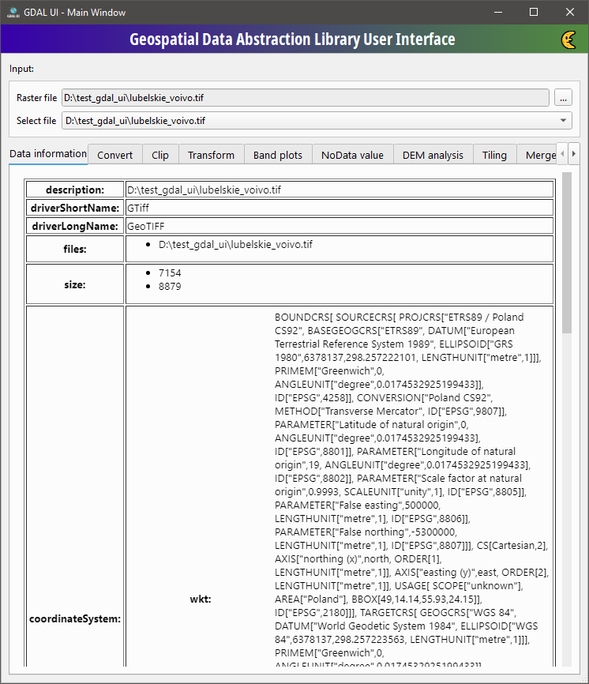
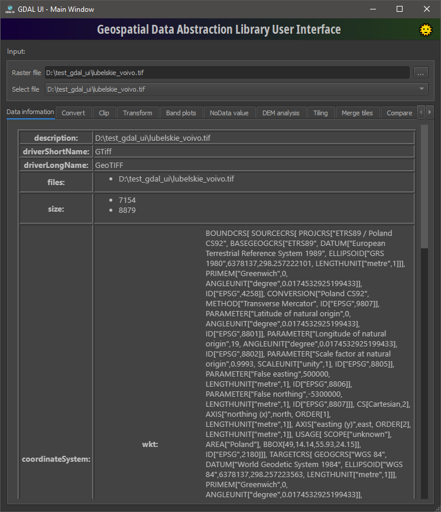

## GDAL UI: Geospatial Data Abstraction Library User Interface
**Simple graphical interface for the GDAL library.**

<p align="center"> <p>

### Description:
Desktop application (Python, PyQt6) with a tab per GDAL operation. Load one or more rasters in the
**Input** box, pick the current file and work on it in the tools below. Tools that need several files
(Merge tiles, VRT, Compare) use all loaded rasters. Everything runs through the GDAL Python bindings,
so no GDAL command line tools have to be installed or on `PATH`.

Available tools:
- **Data information** – full gdalinfo output as a table
- **Convert** – gdal_translate: output data type, resampling, EPSG override, statistics
- **Clip** – gdalwarp with a vector mask (cutline), with a preview of the mask over the raster
- **Transform** – gdalwarp: reprojection between EPSG codes, data types, resampling, NoData
- **Band plots** – histogram of the selected band
- **NoData value** – show and change the NoData value, into a new file or in place
- **DEM analysis** – gdaldem: hillshade, slope, aspect, color-relief, TRI, TPI, roughness
- **Tiling** – gdal raster tile: TMS or XYZ tiles, zoom range, tile size, resampling
- **Merge tiles** – mosaic of all loaded rasters, optionally one input per band
- **Compare** – gdalcompare between two loaded rasters
- **VRT** – gdalbuildvrt from all loaded rasters

Light and dark theme are switched with the button in the title bar.

### Requirements:
**Python >= 3.10**, GDAL >= 3.12 with Python bindings, PyQt6, numpy, matplotlib.

On Windows `requirements.txt` installs the [gdal-wheel](https://pypi.org/project/gdal-wheel/) package,
because the official `gdal` package on PyPI has no Windows wheels. Conda or OSGeo4W environments with
`gdal` and `pyqt` 6 work as well; just run `main.py` with that interpreter.

The application uses the PROJ and GDAL data directories shipped with the installed `osgeo` package, so a
`PROJ_LIB` or `GDAL_DATA` variable left in the environment by other software (PostGIS, QGIS) does not
break coordinate operations.

### Installation:
```bash
git clone https://github.com/eryk918/GDAL_UI
```

```bash
cd GDAL_UI
```

```bash
python -m venv venv
```

```bash
venv\Scripts\pip install -r requirements.txt
```

### Usage:
```bash
venv\Scripts\python main.py
```
